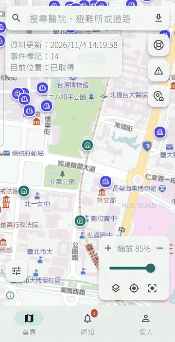
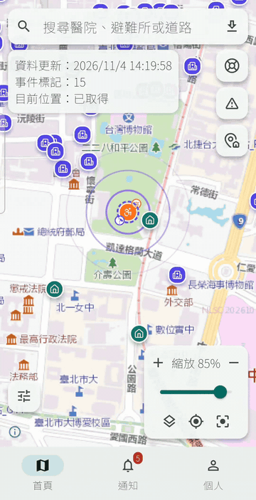
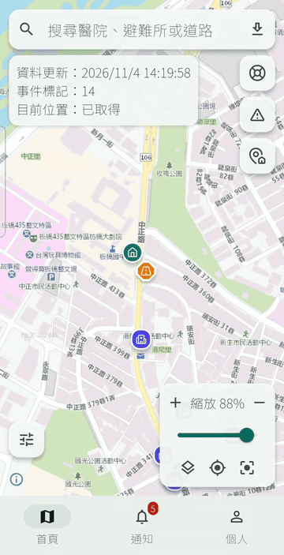
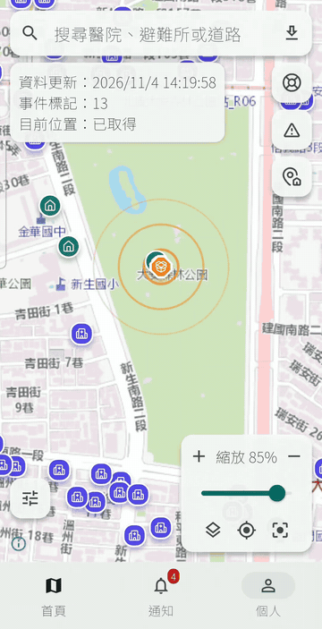
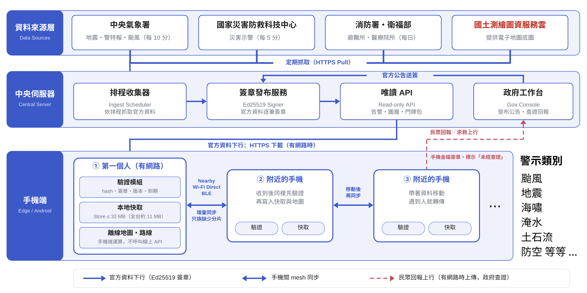

# Resilient Geo Mesh

> 極端通訊環境下的空間情報系統：當基地台總頻寬受限，讓附近手機交換彼此缺少的災情資料。

## 專案呈現

Resilient Geo Mesh 是一款面向災害通訊受限情境的整合式 App。它把全台離線地圖、災情資料、附近裝置交換與逃生路線規劃整合在一起，減少重要資訊仰賴單一基地台重複提供。

核心概念：減少大量裝置重複向伺服器下載相同資料，讓有限的網路頻寬留給尚未取得資料的使用者。


### App 操作展示

<table>
  <tr>
    <td align="center"><br>登入畫面</td>
    <td align="center"><br>民眾求救</td>
    <td align="center"><br>求救通知</td>
  </tr>
  <tr>
    <td align="center"><br>淹水通報</td>
    <td align="center"><br>物資發放</td>
    <td></td>
  </tr>
</table>

## 核心功能

- **離線災情地圖：** Web 與 Android 內附 OSM／Protomaps PMTiles；簽章圖層與告警資料另行驗證載入。
- **Nearby 自動備援交換：** Android 緊急模式依序嘗試 Nearby、Wi-Fi Direct、BLE；裝置間交換不需網際網路，Nearby 需要 Google Play services。
- **可信資料同步：** 交換雙方缺少的資料分片，驗證 hash、Ed25519 簽章、版本與 TTL 後才寫入本機資料庫。
- **災情回報與求救點：** 使用者可回報災情或建立求救點；未經查證的回報會清楚標示，並與官方資料分開保存。
- **離線逃生路線：** Android 依已驗證事件規劃步行路線；事件更新、到期或災害情境變更時自動重算。Web 不執行路線計算。
- **可重現模擬：** 比較不同交換策略的資料覆蓋率、新鮮度與伺服器流量節省情形。

## 系統架構



系統包含 Flutter 地圖介面、Android 原生資料驗證與傳輸、資料整理與簽章管線，以及用於比較交換策略的模擬器。


## 問題與目標

災害發生時通訊資源下降，但民眾與救援人員對「最新空間資訊」的需求反而急遽上升。現有地圖與防災服務多半依賴持續連網下載，因此會出現**有訊號、卻來不及取得關鍵資訊**的情況：地圖載不出來、關鍵資訊跟不重要的資訊一起搶頻寬、災前下載的離線地圖沒有災後新增的道路封閉與避難所滿載。

這不是假想情境。NCC 2025 Q1 統計行動通訊用戶約 2,879.5 萬、單季行動數據傳輸量 3,067.6 PB；2025 年丹娜絲颱風造成 1,293 座行動基地台受影響、12,296 戶市話中斷；2026 年城鎮韌性演習更首次納入大規模行動網路降速，14 個縣市、每次 30 分鐘，官方新聞稿記載將下載速率調降至 **256 KB** 等級。**降速、而不是斷網**，就是本專案設定的主要情境。

我們先盤點了既有解法，每一種都有明確的缺口：

| 現有方式              | 做法                             | 缺點                                                           |
| --------------------- | -------------------------------- | -------------------------------------------------------------- |
| 提前下載離線地圖      | 事前下載防災 App、避難地圖、截圖 | **只解決靜態資料**，災後新出現的道路封閉、避難所滿載完全不知道 |
| SMS / CBS 災防告警    | 簡訊或細胞廣播傳送警報           | 極省流量，但**單向、廣播式**，難做個人化路線與附近資源分析     |
| Wi-Fi / 固網 / 市話   | 行動網路慢時改用固定網路         | 必須**附近剛好有可用基礎設施**，不適合正在移動或身處災區的人   |
| 行動基地台 + 低軌衛星 | 災區部署基地台車、OneWeb、微波   | 很重要，但**設備、數量、人力有限**，無法立刻覆蓋所有民眾       |
| 災害漫遊              | 自家基地台損壞後改用其他業者網路 | 解決「沒訊號」，但**不代表頻寬充足**，另一家網路也可能塞爆     |

缺口很清楚：**沒有人處理「災後才發生、必須即時送到每個人手上的那一小塊動態資料」在總頻寬不足時要怎麼散播。** 因此本專題把範圍收斂到資訊的 mesh 交換。

核心洞察，也是本專案唯一想證明的事：

> 在 256 kbps（約 32 KB/s）的降速情境下，mesh **不可能比基地台快** — 我們實測 BLE GATT 只有 3.8–4.4 KB/s，比降速後的基地台還慢 5–10 倍。mesh 的價值不在速度，而在於**不要讓 100 個人從同一座基地台重複下載同一份資料**，把稀缺的總頻寬留給還沒拿到資料的人。

**目標使用者**：災害或演習期間身處降速區域的一般民眾，以及需要掌握現場動態的第一線人員。

**預期影響**：以內湖區 ~500 筆事件、50 節點的可重播模擬為例，加入 peer 交換後資料覆蓋率由 65% 提升到 100%，同時約 87–91% 的位元組不再向伺服器索取。

**定位**：這是既有行動網路、衛星、LoRa、基地台車之外的**額外韌性層**，不取代既有通訊，也不宣稱能創造額外的基地台頻寬。

## 使用技術

| 類型               | 技術／服務                                                                            | 用途                                                                                                                              |
| ------------------ | ------------------------------------------------------------------------------------- | --------------------------------------------------------------------------------------------------------------------------------- |
| AI 模型            | 未使用                                                                                | 本專案為協定與傳輸層研究，不涉及模型推論；所有排程決策（critical-first、rarest-first、地理過濾）皆為決定性規則，以利可重現量測    |
| 前端（行動端）     | Kotlin Android host（minSdk 26／targetSdk 37）+ Flutter module                        | Flutter launcher、Room bridge、Emergency Mode 權限與原生傳輸服務                                                                 |
| 前端（地圖）       | Flutter `maplibre_gl` + OSM／Protomaps PMTiles                                      | 五個隨 App 提供的向量套件；道路搜尋索引與路網獨立；疊加行政區／離島／地標標籤、避難所、醫療 marker 與事件 GeoJSON 圖層。底圖縮放及地理範圍見 `Map_description.md` |
| 後端（資料管線）   | Node.js、`node:crypto` Ed25519、Fastify HTTP API                                          | Pipeline 收集與簽章；Fastify 提供唯讀 Server API                                                                                |
| 後端（模擬與分析） | Node.js 決定性模擬器、`node:test`                                                     | DTN 擴散模擬、四指標報告、位元級可重現性檢查                                                                                      |
| 資料庫             | Room 2.6.1 / SQLite（KSP 註解處理）                                                   | 手機本機事件、版本、到期時間儲存                                                                                                  |
| 密碼學             | Bouncy Castle `bcprov-jdk18on` 1.78.1                                                 | Android 端 Ed25519 驗簽（平台 provider 至 API 33 才支援 EdDSA）                                                                   |
| 傳輸層             | Nearby Connections、Wi-Fi Direct、BLE GATT                                        | 自動依 Nearby、Wi-Fi Direct、BLE 順序嘗試；分片交換不需網際網路                                                                 |
| 資料契約           | JSON Schema（`event-v0`／`manifest-v0`／`chunk-v0`／`peer-summary-v0`／`feature-v0`） | 跨模組介面，pipeline 與 Android 各自實作、以同一份 fixture 交叉驗證                                                               |
| 測試               | Flutter test、JUnit 4、AndroidX Test、`node:test`、Python `unittest`                  | 覆蓋地圖介面、資料契約、驗證、同步與模擬；測試數量及結果以各 runner 的當次輸出為準                                               |
| Sponsor 技術       | 未使用                                                                                | 本次未使用主辦方或贊助商提供的服務；pipeline 與 simulator 零第三方相依，Android 端僅用 AndroidX 與 Bouncy Castle                  |

> 2026-09-05 的候選評估與失敗紀錄保留在 [`docs/adr/ADR-001-transport-layer.md`](docs/adr/ADR-001-transport-layer.md)。本段是 09-05 的歷史結論，已被取代：Wi-Fi Direct 於 2026-10-04 重新實作並通過雙機資料交換，當時的 TCP 逾時不代表技術不可用；Nearby Connections 於 2026-10-10 加入並成為自動模式的第一優先（需 Google Play services，詳見 [Nearby 與自動備援](docs/nearby-auto-transport.md)）。新版本的搜尋延遲、實測條件與限制見 [Wi-Fi Direct 文件](docs/wifi-direct.md)。

## 安裝與執行

### 需求

- Node.js 20+（pipeline 與 simulator，無需 `npm install`，零外部相依）
- Python 3.10+（replay 測試，僅用標準庫）
- Flutter 3.29.2／Dart 3.7.2（台灣離線地圖 module）
- JDK 17+ 與 Android SDK（Android App；Android Studio 內建的 JBR 即可）

```bash
git clone https://github.com/Jiruiii/OSS.git
cd OSS

# ---------- 1. 驗證整套資料契約與模擬器（不需要手機，約 1 分鐘） ----------
npm test                                   # pipeline + simulator
python -m unittest discover -s tests -v    # Windows 繁中環境請先設 PYTHONUTF8=1

# ---------- 2. 產生並驗證一份真實簽章的資料封包 ----------
node pipeline/cli.mjs keygen --out-dir .stage2-keys --key-id neihu-demo-2026
node pipeline/cli.mjs build \
  --input data/fixtures/neihu/demo-v136.json \
  --out-dir .neihu-bundle \
  --private-key .stage2-keys/private-key.pem \
  --key-id neihu-demo-2026
node pipeline/cli.mjs verify \
  --manifest .neihu-bundle/manifest.json \
  --chunks-dir .neihu-bundle/chunks \
  --public-key .stage2-keys/public-key.pem \
  --now 2026-09-01T08:00:00Z

# ---------- 3. 重現實驗報告（三種策略的差異） ----------
node simulator/cli.mjs run --nodes 50 --strategy no-coop      --seed 20260904 --out .sim-out
node simulator/cli.mjs run --nodes 50 --strategy rarest-first --seed 20260904 --out .sim-out
node simulator/cli.mjs run --nodes 50 --strategy rarest-first --seed 20260904 --geo-filter --out .sim-out
node simulator/cli.mjs matrix --check      # 位元比對已提交的 experiments/results/，應為 PASS

# ---------- 4. Flutter Chrome UI ----------
cd flutter
git lfs pull
flutter pub get
flutter run -d chrome --no-web-resources-cdn --web-port 8787

# Chrome 離線 preview（先建置，再由本機 static server 提供）
flutter build web --release --no-web-resources-cdn
python3 -m http.server 8788 --directory build/web

# ---------- 5. Android 離線地圖（需實機或模擬器） ----------
# 先建立 android/local.properties，內容為 sdk.dir=<Android SDK 路徑>
cd ../android
./gradlew assembleDebug                    # 建置地圖 App；OSM PMTiles 隨 App 提供
./gradlew installDebug                     # 安裝到已連線的裝置

# ---------- 6. Android／資料層測試 ----------
./gradlew :app:testDebugUnitTest           # 目前 261 項 JVM 單元測試（2026-10-28）；不加 :app 會連第三方 plugin 的測試一起跑，geolocator_android 有 3 項失敗
./gradlew connectedDebugAndroidTest        # 目前 46 項 instrumented 測試；2026-10-27 於 Pixel 8a 與 Samsung SM-A5360 實機全數通過，測試使用獨立資料庫，不寫入已安裝 App 的資料
```

地圖搜尋是離線本機查詢：`flutter/assets/map/search/taiwan-roads.json` 由指定日期的
Geofabrik Taiwan OSM PBF 產生，資產內保存 `source_url`、`source_sha256`、snapshot
日期與 `© OpenStreetMap contributors` attribution。可輸入道路名稱或
`latitude, longitude`（例如 `25.011549, 121.545053`）；門牌地址則使用已下載的縣市包。
執行期間不呼叫 Nominatim、Google Geocoding 或 Places API。OSM／Protomaps PMTiles 是向量底圖，
道路搜尋索引與路線網路仍是獨立資料。底圖與相機限制見 [Map_description.md](Map_description.md)；道路索引的重建與 hash 驗證命令見
[`tools/maps/README.md`](tools/maps/README.md)。

Chrome debug 使用本機 MapLibre GL JS、PMTiles、glyph、sprite、CanvasKit 與 UI
字型；`--no-web-resources-cdn` 會避免 Flutter engine 從 gstatic 下載資源。要做
真正的無網路檢查，使用上面的 release preview，在瀏覽器 Network 面板確認請求都
留在 `localhost`。

App 主畫面直接進入 Flutter 台灣離線地圖，底圖使用隨 App 提供的 OSM／Protomaps 向量 PMTiles，並疊加縣市到村里的分級地名、離島與著名地標、避難所／醫療院所／事件圖層。本機搜尋、百分比縮放、目前位置、圖層設定、點位詳情與重疊點位選擇仍由獨立資料提供；marker 在縮小時會聚合成圓點，點擊後再展開或進入下一層。下方另有首頁、通知、個人設定三個頁籤。「載入內建 fixture」與 Emergency Mode 仍由 Android bridge 執行。Peer Sync、BLE spike 與量測畫面是 debug-only 的原生測試 harness，不放在一般地圖主畫面。

**兩機 peer sync 實測**需要兩台開啟藍牙的 Android 裝置，debug APK 可由 Android Studio 啟動對應的 `PeerSyncMilestoneActivity`，再分別指定 NODE_A（requester）／NODE_B（server）角色。逐步 demo 講稿見 [`experiments/demo.md`](experiments/demo.md)；Android 端建置細節與踩雷紀錄見 [`android/README.md`](android/README.md)。

### 實測與模擬結果摘要

實機（Pixel 7 / Pixel 8a / Sharp SH-M32）：

| 項目                     | 結果                                                                                                                |
| ------------------------ | ------------------------------------------------------------------------------------------------------------------- |
| BLE GATT 吞吐量          | 3.8–4.4 KB/s（10s／30s／60s 接觸窗多輪量測）                                                                        |
| 斷點續傳                 | 位元組級續傳成功（中斷點回報的 `bytesTransferred` 直接作為下次 `resume()` 的 offset）                               |
| 跨品牌相容性             | Google Pixel（API 37）+ SHARP（API 35），滿足「兩品牌、兩 Android 版本」                                            |
| 三機 Store-Carry-Forward | A 完全 force-stop 後，C 仍經 B 收到並驗證全部 4 筆簽章事件（含一個中斷又續傳的 chunk）                              |
| 不重複下載（核心主張）   | 第二次相遇時 `DIFF: missing=[]`，「already in sync」——節點從本機庫存如實宣告持有，一個 byte 都不重傳                |
| 連線成功率               | 亮屏 17/20（85%，p50 289ms）；**鎖屏 0/19（0%）** — 這正是 Emergency Mode 需要前景服務的直接證據                    |
| 耗電                     | baseline 385 mW → Emergency Mode 439 mW（**+54 mW，+14%**，螢幕關閉、6 輪交錯各 60 筆）；約等於每小時多耗 0.3% 電量 |

模擬（內湖五個生活圈、約 500 筆事件、24 回合 × 30 秒，以 50 節點為例）：

| 策略                      | Coverage (final) | Cellular Savings | Freshness p50 |
| ------------------------- | ---------------: | ---------------: | ------------: |
| `no-coop`（各自下載）     |            65.1% |               0% |          360s |
| `replication`（一般 P2P） |             100% |            87.1% |          150s |
| `rarest-first`            |             100% |            86.6% |          150s |
| `rarest-first` + 地理過濾 | 100%（relevant） |        **91.3%** |      **120s** |

完整 24 格矩陣、ASCII 曲線與每個區塊的樣本數見 [`experiments/results/report.md`](experiments/results/report.md)。

## 限制與未來工作

如實揭露，不是藉口：

**已知限制**

- **地圖與點位採離線版本。** OSM／Protomaps 底圖隨 App 提供；NLSC／OSM 切換介面、底圖下載器及 Server `/maps/*` 路徑已移除；`TaiwanEMap6.mbtiles` 僅保留作為歷史試用來源。五個 OSM PMTiles、zoom 與地理範圍記錄在 `Map_description.md`。簽章靜態資料、告警 feed 與門牌搜尋串接仍在 Web／Android 保留；17 個縣市的門牌包已簽章產生。基隆市官方 CSV 已找到且完成實檔試跑，但簽章金鑰未設定，尚未併入 catalog；連江、宜蘭、南投與嘉義市仍未找到可用的完整門牌座標來源。新 Server 尚未部署，尚未證明兩端已下載同一個正式發布版本。2026-10-04 本機重收集的醫療主檔有 479／24,138 筆已定位，另有 23,659 筆未定位；避難處所有 5,727／5,973 筆通過座標與行政區核對。本機暫存點位 bundle 已簽章並由 Web、Android 模擬器下載驗證。當日 Android 模擬器對 NLSC 試用底圖做過 SHA-256 與飛航模式驗證，API 36 模擬器也曾驗證底圖下載；這些是 10-05 移除 NLSC 下載流程前的歷史驗收，不能代表目前隨 App 內附 OSM 底圖的重新驗收。正式 HTTPS 服務與 Android 實機驗收仍待完成。
- **不宣稱在任何固定時間覆蓋全城。** 所有模擬數字只適用於 [`experiments/scenario.md`](experiments/scenario.md) 描述的內湖情境與接觸模型，單一 seed，非多次抽樣的信賴區間。
- **模擬參數只校準了一半。** `max_bytes_per_round` 已用實機 BLE 接觸窗量測校準；`contact_probability`（社交接觸機率）與 `transfer_failure_prob` 仍是工程估計值 — 現有實機數據沒有一項直接對應到這兩個參數，硬套上去會是假精確。
- **耗電只有單一機型、單一 60 秒視窗、只涵蓋持續傳輸**，不是 Emergency Mode 真實的間歇性接觸型態，也未涵蓋鎖屏情境。
- **自動同步已通過兩機初步實測，完整驗收仍待完成。** 2026-09-27 在 Pixel 8a／Sharp SH-M32 關閉 Wi-Fi 與行動數據後，真實 BLE 與同步引擎完成互補缺片；重建 transport 再次相遇時不重複傳片。測試使用獨立資料庫；正式服務另確認熄屏時可以完成已有資料的 HELLO 核對。2026-10-27 在 Pixel 8a／Samsung SM-A5360 以同一測試分別驗證 BLE、Nearby 與 Wi-Fi Direct 三種傳輸的互補與再次相遇；Wi-Fi Direct 第二次相遇偶有探索逾時（6 輪中 1 輪）。三機自動中繼、長時間 Doze 及正式成功率統計仍待完成，詳見 [可靠性與實機驗證](docs/reliability-device-validation.md)。
- **民眾回報與逃生路線仍需現場驗證。** 兩者都有 JS／Kotlin JVM／Flutter 自動化測試（含用真實簽章重播 A→B→C 轉傳，以及逃生路線的三步驟 demo 情境）；雙北路線另有 Pixel 8a USB instrumentation 與 profile 畫面量測，並非實際災害或多人現場測試。回報送到政府端、確認事件送回手機，目前都靠 debug build 的 `adb` 匯出／匯入。裝置金鑰沒有撤銷機制，同一把金鑰的回報可以被串起來；「N 人回報」可以被一人多機灌票，所以不等於驗證。
- **逃生路線只有步行、涵蓋雙北及邊界緩衝區**，遵守 OSM `oneway:foot` 與步行存取限制，但沒有高程資料。中央 Server 目前只收集靜態避難所位置與預計容量，不收集更新不定期的開設狀態；舊 fixture/replay 與手機端既有狀態處理仍保留，不代表即時狀態可用。使用者可選六種災害情境篩選，類別不明時保留警告，不自動推斷情境。路網外或未連接的場所仍可能無可達路線。原始內湖路網與測試保留。路線不是官方疏散指示；操作與同步狀態頁見 [功能紀錄](docs/sync-status-disaster-filter.md)。
- **自動同步不支援跨接觸續傳。** 如果接觸窗關閉導致真的斷線，傳到一半的分片不會保留狀態，下次相遇會從第 0 個 byte 重傳。位元組級續傳目前只在同一條連線還開著時有效。
- **長時間 Doze 與跨機型 20 次連線成功率尚未補齊。** 本輪正式前景服務已有短時間熄屏心跳及 HELLO 核對證據；USB 充電時裝置 idle 狀態仍是 ACTIVE，不能視為 Doze 驗收。
- **前景服務耗電量測只涵蓋「持續發現」，不含傳輸。** +54 mW 是舊版 discovery-only 服務的待命成本，目前自動同步服務的耗電尚未量測；舊量測只有 1 台機型、鄰居數固定為 1。（同日稍早那組 22.35→26.78 mW 已作廢——當時手機插著 USB 且滿電，量到的是計量器雜訊，詳見 `experiments/results/energy-raw/README.md`。）
- **手動 Peer Sync 畫面的 server 端仍然從 `assets/` 供應分片。** 自動同步則不同：節點會把驗證通過的分片本體存進本機 `chunk-cache`（上限 8 MB，超過時先刪最舊的），再從這裡供應給下一個 peer，所以中繼節點真的能轉傳自己收到的資料。不過這條中繼路徑同樣還沒做實機驗證。

- **固定大小切分讓版本更新無法真正 delta**：`fixed-size` 切分下，資料集只要有一筆事件變動，同組後面所有 chunk 的邊界就會位移、hash 全變。
- **HELLO 表示法會隨資料集線性膨脹**：目前逐條列舉 chunk（183 chunk 約 36 KB）；全台規模會膨脹到數百 KB，在一次接觸窗內傳不完。

**未來工作**

- 部署新 Server／Web build 與簽章門牌 catalog，外部驗證 HTTPS，並把 Android 服務網址切到該網域；簽署新版本時納入已驗證的基隆包。
- 以正式發布的同一批資料完成 Web／Android 實機離線驗收；OSM 內建底圖須確認安裝容量、縮放和地理範圍，另有 5 縣市門牌來源待補。
- 以 **Bloom filter 或對 manifest 順序的 bitmap** 取代逐條列舉的 HELLO（同樣 183 chunk 只要 23 bytes，省約 1,500 倍），讓資料集可擴展到全台規模。
- 導入**內容導向切分（CDC / rolling hash）或組內單事件對齊**，讓版本更新能真正 delta 傳輸而非整組重傳。
- 補齊跨機型連線成功率統計、鎖屏／Doze 長時存活驗證，以及間歇性接觸模式下的耗電量測。
- 讓 Emergency Mode 服務自行完成連線與同步（含兩台裝置相遇時的自動角色協商），把「開著就會自己交換」變成真的。
- 讓節點能重新供應自己持有的分片位元組，而不只是宣告持有。
- 用兩機、三機實機驗證 Emergency Mode 的自動同步與中繼轉傳，並補上跨接觸的續傳狀態保存。
- **民眾回報的後續**：真的上傳 API 與政府端後台（取代 debug 匯出／匯入）、現場授權人員的離線確認（需要授權憑證鏈與撤銷機制）、定期更換裝置金鑰以降低可串連性、信譽評分。
- **逃生路線的後續**：擴大到全台路網、高程與垂直避難建議、以及把 `CONFIRMED` 的封路回報改由政府直接簽發 `ROAD_STATUS`，讓路線真正避開。
- 完成基隆包重簽發布；再為目前沒有來源的連江、宜蘭、南投、嘉義市尋找合法完整座標資料，或持續明確標示 unavailable。

完整版見 [`experiments/limitations.md`](experiments/limitations.md) 與 [`docs/mvp-remaining-tasks.md`](docs/mvp-remaining-tasks.md)。

## 第三方服務、資料與素材

repo 內不含任何 API 金鑰、Token 或個人資料。金鑰僅由本機 gitignored 的 `pipeline/.env` 提供（範本見 `pipeline/.env.example`），且從不寫入 Raw snapshot、fixture、log 或 Android bundle。Ed25519 私鑰只在伺服器端 CLI 執行當下存在，從未提交進 repo。

**資料來源**

| 來源                            | 連結                                                                                          | 授權                                                     | 用途與現況                                                                                                              |
| ------------------------------- | --------------------------------------------------------------------------------------------- | -------------------------------------------------------- | ----------------------------------------------------------------------------------------------------------------------- |
| OpenStreetMap（Overpass API）   | <https://overpass-api.de/api/interpreter>                                                     | ODbL，需標示 attribution（© OpenStreetMap contributors） | 保留內湖 legacy 快照；Central Server 的 `osm-taiwan` 目前停用，不作為醫療座標來源；道路名稱搜尋另用 OSM 本機索引                         |
| Geofabrik Taiwan OSM PBF        | <https://download.geofabrik.de/asia/taiwan-latest.osm.pbf>                                    | ODbL，需保留 OpenStreetMap attribution                   | `flutter/assets/map/search/taiwan-roads.json` 的離線道路搜尋來源；產生日期與 SHA-256 保存在資產 metadata                |
| NLSC 臺灣通用電子地圖           | <https://maps.nlsc.gov.tw/pro/download.jsp>                                                   | 政府資料開放授權；保留來源 attribution                    | 僅保留原始 `TaiwanEMap6.mbtiles` 作為歷史試用資料；不由目前 App 或 Server 發布。metadata 與試用範圍見 `Map_description.md` |
| 臺灣行政區邊界與地名資料         | <https://cdn.jsdelivr.net/npm/taiwan-atlas/towns-10t.json>                                    | MIT（來源為臺灣內政部資料衍生集）                         | `flutter/assets/map/labels/taiwan-reference-labels.geojson` 的縣市、區／鄉鎮、市／村里分級標籤；離線隨 App 載入。同一資產另維護離島名稱與著名地標 |
| 臺北市區界圖                    | <https://data.taipei/dataset/detail?id=1601ef3a-c253-4988-b047-943d9e786143>                  | 臺北市資料開放授權                                       | **僅供 pipeline 的內湖空間過濾**，不是 Flutter 全台底圖來源                                                                   |
| 消防署避難收容處所點位檔        | <https://data.gov.tw/dataset/73242>                                                           | 政府資料開放授權條款第 1 版                              | 第一階段接全台靜態避難所位置與預計容量；不收集更新不定期的開設狀態，內湖 legacy 快照仍保留                |
| 醫療機構與人員基本資料          | <https://data.gov.tw/dataset/15393>                                                           | 政府資料開放授權條款第 1 版                              | Central Server 接全台 MOHW ODS 主檔；座標以 NLSC 與已審核官方來源補足，無法唯一定位者保留 `unresolved`，不畫 marker |
| TDX 運輸資料流通服務 — 道路事件 | <https://tdx.transportdata.tw/api-service/swagger/basic/60abfa19-ffe3-4eef-a4b1-0539435dfca9> | TDX 服務條款與資料授權                                   | 保留 OAuth2 adapter 供日後 opt-in；目前 Central Server 停用，不進核心災害 feed                         |
| 中央氣象署 CWA — 地震與警特報   | <https://opendata.cwa.gov.tw/dataset/earthquake/E-A0015-001>                                  | CWA 氣象開放資料平臺服務條款                             | 第一階段接地震、縣市警報、颱風；API key 僅在 pipeline 本機使用，App 不直接呼叫                                           |
| NCDR 災害示警                   | <https://alerts.ncdr.nat.gov.tw/api_swagger/index.html>                                      | NCDR 平臺條款或來源機關授權                              | 第一階段 adapter 使用 `/api/datastore` → `/api/dump/datastore` 兩階段 CAP API；key 僅在 pipeline 本機使用，App 不直接呼叫 |
| NCC 鄉鎮區基地臺統計            | <https://data.gov.tw/dataset/41256>                                                           | 政府資料開放授權條款第 1 版                              | 僅保留來源 metadata，尚未接入地圖或計算訊號覆蓋／中斷風險                                                             |
| 內政部 20m DTM／DEM·DSM         | <https://data.gov.tw/dataset/176927>                                                          | 政府資料開放授權條款第 1 版                              | 僅保留來源 metadata，尚未接入地圖或地形分析                                                                         |
| Copernicus Data Space（STAC）   | <https://documentation.dataspace.copernicus.eu/APIs/STAC.html>                                | Copernicus Data Space Ecosystem 資料條款                 | 僅保留來源 metadata，尚未下載影像或進行災害判釋                                                                     |

> **重要聲明**：OSM／Protomaps 底圖隨 App 提供，可離線使用；政府簽章靜態 layer、告警 feed 與門牌包透過資料服務串接。Server 尚未部署時，不能宣稱 Web／Android 已取得最新院所資料；舊的靜態預覽不作為 Web 驗證失敗時的替代點位。`data/fixtures/neihu/` 與 Android `fixtures/signed-events.json` 是可重播／合成資料，不代表真實災況。底圖限制見 [Map_description.md](Map_description.md)，資料來源及驗收狀態見[資料說明](data_description.md)與[`pipeline/sources/catalog.json`](pipeline/sources/catalog.json)。

**軟體相依**

| 套件                                                                 | 授權                              | 用途                                                |
| -------------------------------------------------------------------- | --------------------------------- | --------------------------------------------------- |
| AndroidX（core-ktx、appcompat、recyclerview、lifecycle、room、test） | Apache-2.0                        | Android 基礎元件與本機資料庫                        |
| Material Components for Android                                      | Apache-2.0                        | UI 元件與主題                                       |
| Bouncy Castle `bcprov-jdk18on`                                       | Bouncy Castle License（MIT 風格） | Ed25519 驗簽                                        |
| `org.json`                                                           | Public Domain                     | JVM 單元測試中的 JSON 解析（Android 內建版為 stub） |
| kotlinx.coroutines                                                   | Apache-2.0                        | 非同步傳輸流程                                      |
| Fastify                                                              | MIT                               | Central Server 的 HTTP API                         |
| Google Play Services Nearby                                          | Google APIs 服務條款              | 自動交換的優先候選；無 GMS 時使用原生 Wi-Fi Direct / BLE 備援  |
| JUnit 4                                                              | EPL-1.0                           | 單元測試                                            |

pipeline 與 simulator 的資料處理使用 Node.js 內建模組；Central Server 使用 Fastify 提供 HTTP API。Python 測試僅使用標準庫。啟動畫面使用專案內的 Geo light/dark phone logo；Android 原生 starting window 使用對應的 square logo，會依系統深色模式切換。

## 團隊成員

| 姓名                                                               | 分工                                                                                                                                              |
| ------------------------------------------------------------------ | ------------------------------------------------------------------------------------------------------------------------------------------------- |
| <!-- TODO: 姓名 --> ([@Jiruiii](https://github.com/Jiruiii))       | 實機整合與量測：把 Peer Sync 協定接上 `BleGattTransport`、兩機／三機實機測試、前景服務背景與鎖屏驗證、接觸窗吞吐量與耗電量測                      |
| <!-- TODO: 姓名 --> ([@CC10206](https://github.com/CC10206))       | 協定邏輯與量測分析：Kotlin 版 `computeDiff`／`buildRequest` 與 JVM 單元測試、Emergency Mode UI 與前景服務骨架、simulator 校準、實驗報告與文件維護 |
| <!-- TODO: 姓名 --> (wangchingchuen)                               | 資料管線與資料來源：多來源 collector、正規化、`(area_id, theme)` 地理分片、Ed25519 簽章與驗證、內湖資料集生成                                     |
| <!-- TODO: 姓名 --> ([@Raiden1121](https://github.com/Raiden1121)) | Flutter 前端與地圖整合：以 Flutter + MapLibre 建置全台灣離線地圖主畫面，整合本機 PMTiles、glyph、sprite、樣式、行政區／離島／地標標籤與道路搜尋；串接 Android bridge 的 Room 已驗證事件，載入避難所／醫療院所靜態資料，完成 marker 聚合、事件圖層、搜尋、縮放、目前位置與點位詳情互動 |

> 上表的 GitHub 帳號取自 commit 紀錄，**請團隊補上對應真實姓名後再送出**。

## License

**Apache License 2.0** — 完整條文見儲存庫根目錄的 [`LICENSE`](LICENSE)。

> 注意：程式碼授權與**資料授權相互獨立**。本專案的 OSM 衍生資料（底圖 PMTiles、`data/fixtures/neihu/osm-snapshot.json`、`flutter/assets/map/search/taiwan-roads.json` 與雙北步行路網）受 **ODbL** 規範，散布時須保留 OpenStreetMap attribution。保留的 NLSC MBTiles 依其政府資料授權標示來源；行政區標籤與其他素材則依各自來源的授權條款（見上方「第三方服務、資料與素材」）。

---

### 延伸文件

目前文件入口與歷史計畫清理紀錄見 [文件索引](docs/README.md)。

| 文件                                                                         | 內容                                               |
| ---------------------------------------------------------------------------- | -------------------------------------------------- |
| [`system.md`](system.md)                                                     | 系統實作計畫、開發階段與驗收條件、風險與停止條件   |
| [`docs/data-contract-v0.md`](docs/data-contract-v0.md)                       | Event／Feature／Chunk 的欄位、身分、版本與簽章規則 |
| [`docs/peer-sync-v0.md`](docs/peer-sync-v0.md)                               | HELLO → DIFF → REQUEST 協定與跨版本 DTN 規則       |
| [`docs/adr/ADR-001-transport-layer.md`](docs/adr/ADR-001-transport-layer.md) | 傳輸層選型：三個候選的完整實機記錄與否決理由       |
| [`docs/mvp-remaining-tasks.md`](docs/mvp-remaining-tasks.md)                 | MVP 剩餘待辦與完成標準                             |
| [`docs/taipei-offline-routing.md`](docs/taipei-offline-routing.md)           | 雙北路網來源、Pixel 8a 延遲／記憶體實測與重跑方式    |
| [`android/README.md`](android/README.md)                                     | Android 專案結構、建置踩雷紀錄與設計決策           |
| [`experiments/README.md`](experiments/README.md)                             | 實驗產物、重新產生方式與主要結論                   |
| [`C_BLEbroadcast.md`](C_BLEbroadcast.md)                                     | BLE 實機測試的原始工作筆記                         |

## 專案更新紀錄

- **2026-09-24：** Android App launcher 改為 Flutter module 的全台灣離線地圖；Android 原生保留 Room、事件驗證／TTL、BLE 與 transport harness，Flutter 透過 bridge 只讀取已驗證事件。
- **2026-09-27：** 路線支援事件更新、到期及災害情境變更時自動重算；推薦模式會重新比較可達避難所並顯示更新原因。詳見[路線自動重算](docs/automatic-route-refresh.md)。
- **2026-10-05：** Web 與 Android 使用隨 App 提供的 OSM／Protomaps PMTiles；NLSC／OSM 切換介面、底圖下載器及 Server `/maps/*` 路徑已移除，僅保留 `TaiwanEMap6.mbtiles` 作為歷史試用來源。五個 PMTiles、zoom 與經緯度限制見 [Map_description.md](Map_description.md)。政府簽章 feed、靜態圖層、門牌包及 Web／Android 資料串接仍保留；本機資料與逐縣市涵蓋見[資料說明](data_description.md)及[點位涵蓋報告](docs/data-coverage-2026-10-04.md)。正式 HTTPS Server 與 Android 實機驗收仍待完成。
- **2026-10-10：Nearby 與自動備援。** 在「個人設定 → 同步狀態」開啟緊急模式，自動優先嘗試 Nearby，再嘗試 Wi-Fi Direct，BLE 保持可用作備援；不需網際網路。Nearby 需 Google Play services，原生備援不需要。策略、權限、Web 限制與實機驗證紀錄見[自動交換文件](docs/nearby-auto-transport.md)。
